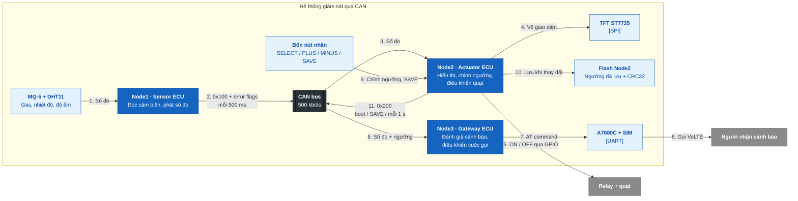
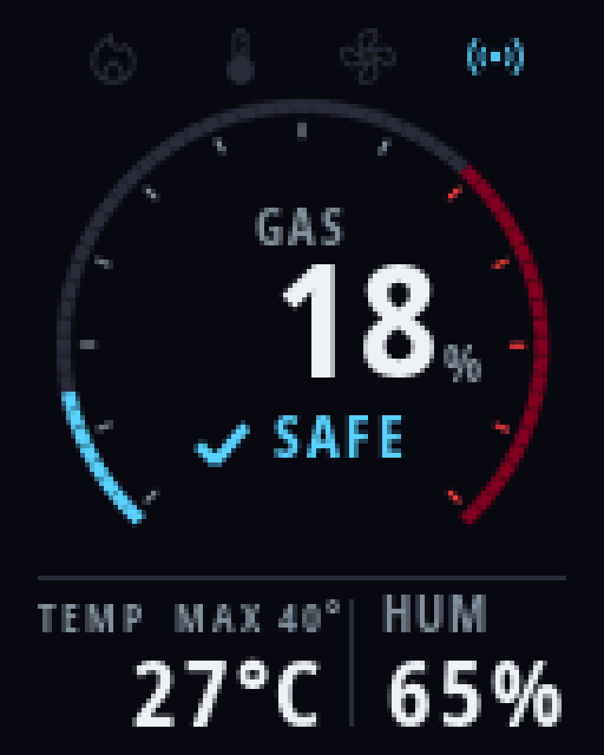
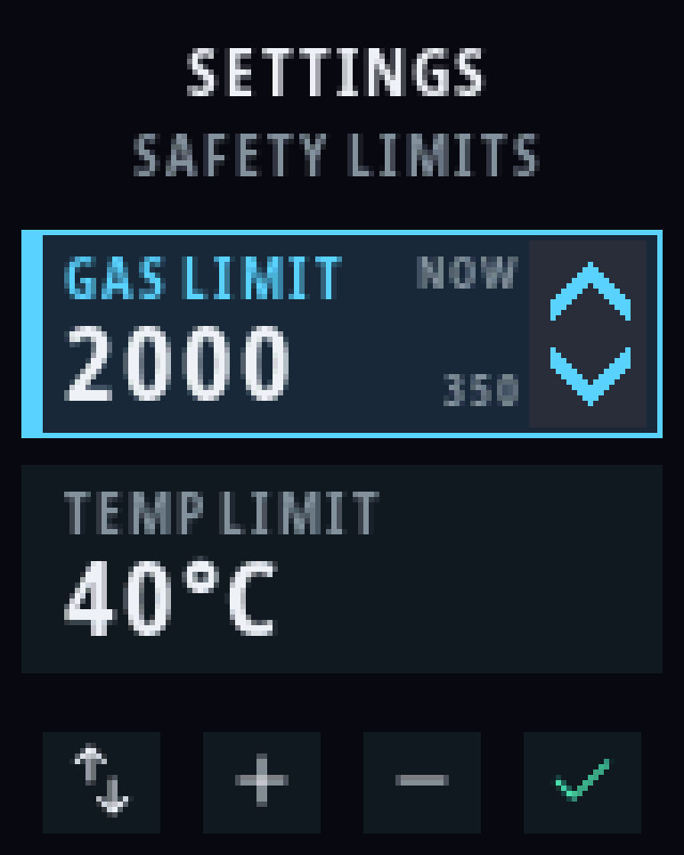

# Automotive CAN Gateway

Hệ thống giám sát gas, temperature và humidity bằng **ba STM32F103C8T6 chạy FreeRTOS**, nối qua Classical CAN 500 kbit/s. Node1 đọc cảm biến; Node2 hiển thị lên TFT, chỉnh ngưỡng và điều khiển quạt; Node3 gọi điện cảnh báo qua modem A7680C. Hai consumer tự quyết định từ cùng số đo; Node2 cung cấp cấu hình ngưỡng cho Node3.

Bản release: [v1.1.0](https://github.com/TranVanVinh74/CAN_RTOS/releases/tag/v1.1.0).

## Cấu trúc Repository

```text
CAN_RTOS/
├── README.md                                ← bạn đang ở đây: tổng quan, cách chạy và kết quả
├── LICENSE                                  ← MIT License cho source nhóm viết
├── THIRD_PARTY.md                           ← nguồn và license của font/icon UI
│
├── common/                                  ← định nghĩa dùng chung giữa ba node
│   ├── can_protocol.h                       ← CAN ID, DLC, payload và pack/unpack
│   ├── alert_thresholds.h                   ← defaults, range và hysteresis của ngưỡng
│   └── sensor_status.h                      ← sensor error flags và policy theo số đo hợp lệ
│
├── node1-sensor/                            ← Sensor ECU: MQ-5 + DHT11 → CAN
│   ├── app/                                 ← SENSOR task, CAN_TX task và sensor queue
│   ├── hal/                                 ← driver ADC/MQ-5, DHT11 và CAN TX
│   └── node1-sensor.ioc                     ← cấu hình CubeMX của Node1
│
├── node2-actuator/                          ← Display & Actuator ECU: TFT, nút và quạt
│   ├── app/                                 ← application logic và FreeRTOS task
│   │   ├── inc/                             ← public headers, cấu hình và kiểu dữ liệu IPC
│   │   └── src/
│   │       ├── task_actuator.c              ← nhận số đo, relay, quét nút và phục vụ UI
│   │       ├── app_ui.c                     ← scene, gas gauge, SETTINGS và trạng thái lỗi
│   │       ├── app_ui_assets.c              ← font và icon đã rasterize
│   │       ├── app_settings.c               ← record settings, CRC32 và kiểm giá trị
│   │       └── app_threshold_sync.c         ← phát ngưỡng active qua CAN 0x200
│   ├── hal/                                 ← driver phần cứng; headers ở inc/, source ở src/
│   │   └── src/
│   │       ├── hal_buttons.c                ← đọc GPIO, debounce và press events
│   │       ├── hal_settings_flash.c         ← erase, program và verify settings page
│   │       ├── hal_tft.c                    ← ST7735, SPI và truyền pixel
│   │       ├── hal_relay.c                  ← điều khiển relay active-HIGH
│   │       └── hal_can.c                    ← CAN RX ISR và CAN TX nonblocking
│   ├── bsp/                                 ← pin mapping, init driver và startup error codes
│   ├── Core/                                ← code CubeMX; phần nhóm viết nằm trong USER CODE
│   ├── Drivers/                             ← STM32 HAL và CMSIS — giữ nguyên vendor source
│   ├── Middlewares/                         ← FreeRTOS — giữ nguyên vendor source
│   ├── node2-actuator.ioc                   ← cấu hình CubeMX của Node2
│   └── STM32F103C8TX_SETTINGS.ld            ← firmware 63 KB + settings page 1 KB
│
├── node3-gateway/                           ← Cellular Gateway: CAN → A7680C → cuộc gọi
│   ├── app/                                 ← COMM task, queues, call state và modem reply parser
│   ├── hal/                                 ← driver UART/A7680C và CAN RX
│   └── node3-gateway.ioc                    ← cấu hình CubeMX của Node3
│
├── assets/                                  ← ảnh dùng trong README
│   └── ui/                                  ← SVG/GIF preview render từ source UI
│
└── .gitignore                               ← loại build outputs, secrets và dữ liệu local
```

Cây trên lược bớt file phụ để làm rõ trách nhiệm từng module. Cả ba node đều là project STM32CubeIDE, có các lớp `app/`, `hal/`, `bsp/`, `Core/`, `Drivers/` và `Middlewares/`; Node2 được mở chi tiết để minh họa cách tổ chức.

Các thư mục `docs/`, `rules/`, `tools/`, `logs/`, `__log/` và file `CLAUDE.md` dùng trong workspace local, đang bị gitignore nên không nằm trong source release trên GitHub.

## Quy ước

- **Ngôn ngữ:** nội dung tiếng Việt, technical terms giữ tiếng Anh (`queue`, `freshness`, `hysteresis`, `debounce`, ...).
- **Tên source:** file/hàm/biến dùng `snake_case`; module có prefix theo lớp (`hal_buttons`, `app_settings`, `task_actuator`); macro và constants dùng `UPPER_SNAKE_CASE`.
- **Ownership:** GPIO và peripheral nằm ở `hal/`, pin mapping ở `bsp/`, policy/task ở `app/`; protocol và policy dùng chung nằm ở `common/`.
- **CubeMX:** đổi cấu hình qua `.ioc` rồi regenerate; phần nhóm viết trong `Core/` chỉ đặt trong `USER CODE`. Không sửa `Drivers/` hoặc `Middlewares/`.
- **Code nhóm viết:** không thêm comment giải thích trong source; dùng tên rõ nghĩa, ghi lý do thiết kế trong tài liệu hoặc commit body. Giữ license và marker của code generate/vendor.
- **Sơ đồ:** mô tả từng luồng bằng sơ đồ ngắn; dùng Mermaid trực tiếp trong `.md` khi cần thể hiện quan hệ hoặc sequence.
- **Commit:** `type(scope): summary` bằng tiếng Anh, dòng đầu tối đa 72 ký tự; mỗi commit một thay đổi logic và phải build được. Commit CubeMX riêng với application code.
- **Thông tin chưa kiểm chứng:** ghi rõ **đã kiểm hardware**, **host/mock** hoặc **⚠ Chưa kiểm chứng**; dùng `[TODO]` cho phần chưa làm. Không coi build/preview là bằng chứng hành vi trên board.

## Mô hình



CAN RX ISR chỉ kiểm frame, giải mã và đẩy vào queue. Task xử lý phần chậm: đọc cảm biến, vẽ TFT và giao tiếp modem. Node2 dùng queue 5 phần tử cho số đo; Node3 dùng hai queue riêng, mỗi queue 1 phần tử ghi đè, để giữ số đo và cấu hình mới nhất.

Một luồng sử dụng: Node1 phát số đo → Node2 cập nhật TFT và relay, Node3 đánh giá call alarm. Người dùng vào SETTINGS, chỉnh ngưỡng rồi SAVE → Node2 lưu flash, áp dụng ngưỡng mới và phát `0x200` → Node3 cập nhật ngưỡng trong RAM. Chỉnh trên màn hình chưa SAVE chỉ là draft, chưa đổi ngưỡng điều khiển.

## Chạy nhanh

Cần STM32CubeIDE **1.18.1**, ST-Link V2 và ba board đã nối CAN. Project dùng STM32CubeMX **6.14.1** / STM32Cube FW_F1 **V1.8.7** khi regenerate `.ioc`.

```bash
# Chạy từ repository root. Tạo cấu hình riêng nếu chưa có.
test -f node3-gateway/app/inc/app_secrets.h || \
    cp node3-gateway/app/inc/app_secrets.example.h \
       node3-gateway/app/inc/app_secrets.h
```

Điền `APP_ALERT_PHONE` trong `app_secrets.h` bằng số nhận cảnh báo. File này bị gitignore; repository chỉ giữ bản example.

1. Trong CubeIDE, chọn **File → Import → Existing Projects into Workspace**, import ba thư mục `node1-sensor`, `node2-actuator`, `node3-gateway`.
2. Build từng project với cấu hình **Debug**. Có thể chọn **Release** trên Node2; cả hai cấu hình đều dùng linker script dành riêng cho settings.
3. Nạp bằng ST-Link vào đúng board. Khi nâng từ firmware dùng sensor frame 4 byte, nạp hai consumer Node2/Node3 trước, Node1 sau; cần cập nhật đủ ba node vì frame mới có 5 byte.
4. Giữ các node chạy trên CAN bus. Node2 hiển thị số đo; SELECT mở SETTINGS, SAVE lưu và thoát. Node3 kiểm modem rồi đánh giá call alarm khi có dữ liệu fresh.

Có thể build bằng command line trên Linux thay cho GUI:

```bash
stm32_ide="${STM32CUBEIDE_HOME:-$HOME/Downloads/STM32CubeIDE}"
build_workspace="$(mktemp -d /tmp/can-rtos-build.XXXXXX)"

for node in node1-sensor node2-actuator node3-gateway; do
    "$stm32_ide/headless-build.sh" \
        -configuration "$build_workspace/$node/configuration" \
        -data "$build_workspace/$node/workspace" \
        -import "$PWD/$node" \
        -cleanBuild "$node/Debug" || break
done
```

### Kết nối chính

| Node | Module | Chân STM32 |
|---|---|---|
| Node1 | MQ-5 | AO qua cầu chia áp về mức ADC 3,3 V → PA1 |
| Node1 | DHT11 | DATA → PA2 |
| Node2 | ST7735 | SCK → PA5, MOSI/SDA → PA7, CS → PB1, DC/A0 → PB10, RST → PB11 |
| Node2 | Relay active-HIGH | IN → PB0 |
| Node2 | Bốn nút active-low | PB12 SELECT, PB13 PLUS, PB14 MINUS, PB15 SAVE; mỗi nút nối GPIO với GND, dùng internal pull-up |
| Node3 | A7680C · USART2 | Modem TX → PA3, modem RX → PA2 |
| Cả ba | SN65HVD230 | CTX → PA12, CRX → PA11; CANH/CANL và GND nối chung |

Bus nối theo tuyến **Node1 – Node2 – Node3**, chỉ đặt termination 120 Ω ở hai đầu Node1 và Node3. Modem dùng nguồn 5 V riêng đủ dòng (≥ 2 A), GND chung với Node3. Quạt 5 V được đóng/ngắt qua tiếp điểm relay.

## Ngưỡng và trạng thái điều khiển

| Tham số | Mặc định | Khoảng chỉnh | Bước | Ngưỡng tắt |
|---|---:|---:|---:|---|
| Gas · raw ADC | 2000 | 500–3800 | 50 | Ngưỡng bật − 200 |
| Temperature · °C | 40 | 30–50 | 1 | Ngưỡng bật − 2 °C |

Khi hai cảm biến hợp lệ: bật khi **gas > ngưỡng bật hoặc temperature > ngưỡng bật**; tắt khi **cả hai < ngưỡng tắt**. Các trường hợp khác giữ trạng thái trước, kể cả đúng bằng ngưỡng. Người dùng chỉ chỉnh ngưỡng bật; hysteresis được suy ra tự động.

Khi có sensor fault, chỉ số đo hợp lệ được kích cảnh báo. Quạt có thể bật nhưng giữ trạng thái nếu chưa đủ dữ liệu xác nhận an toàn; chỉ tắt khi hai cảm biến phục hồi và cả hai dưới ngưỡng tắt. Trong chế độ lỗi, Node3 chỉ giữ call alarm khi kênh còn hợp lệ đang vượt ngưỡng bật; cả hai lỗi thì không gọi từ giá trị giữ lại.

Node3 chỉ tạo automatic call từ dữ liệu fresh (≤ 3000 ms), có khoảng cách tối thiểu **60 s giữa các lần thử gọi** và timeout **30 s**. Alarm hết hoặc dữ liệu stale thì yêu cầu hang-up. Cuộc gọi thất bại không có fallback SMS.

## Giao tiếp CAN

Classical CAN, standard ID 11 bit, data frame. Codec nằm duy nhất trong [`common/can_protocol.h`](common/can_protocol.h); gas gửi high byte trước.

| Frame | Hướng | DLC | Payload | Chu kỳ |
|---|---|---:|---|---|
| `0x100` | Node1 → Node2, Node3 | 5 | `[temperature, humidity, gas high, gas low, sensor faults]` | 500 ms |
| `0x200` | Node2 → Node3 | 3 | `[gas limit high, gas limit low, temperature limit]` | Sau CAN start, khi SAVE đổi cấu hình, mỗi 1 s |

Sensor faults: bit 0 = GAS/ADC read error, bit 1 = DHT11 read error, bit 2–7 phải bằng 0. Frame sai IDE/RTR/DLC hoặc reserved bits bị loại; frame cấu hình còn được kiểm range và bước chỉnh. Flags được tính lại mỗi chu kỳ đọc. Một frame có sensor fault vẫn cho biết CAN đang nhận dữ liệu; sensor validity và freshness được kiểm riêng.

Node3 giữ ngưỡng trong RAM: boot dùng 2000/40 °C tới khi nhận frame hợp lệ đầu tiên; mất Node2 thì tiếp tục dùng ngưỡng nhận gần nhất. Không có application ACK hoặc config expiry.

## Kiểm tra trước khi đẩy

Build các node bị ảnh hưởng, kiểm warning, review diff và giữ source vendor nguyên vẹn:

```bash
git diff --check
git diff --stat
git status --short
```

Khi đổi protocol, cập nhật codec, producer, consumer và tài liệu cùng nhau. Kết quả build/host checks không thay cho kiểm trên board; ghi riêng phần nào đã kiểm hardware, phần nào dùng mock. `main` giữ release ổn định, `develop` tích hợp tính năng, `feature/*` và `integration/*` giữ lịch sử công việc.

## Lưu ý vận hành

- **Mất số đo:** TFT chuyển OFFLINE sau khoảng 3 s không xử lý được số đo mới; relay giữ trạng thái cuối. Node3 không tạo automatic call từ dữ liệu stale.
- **Lỗi cảm biến:** flags báo lỗi đọc driver. Rút dây analog MQ-5 vẫn có thể ADC conversion thành công, nên không bảo đảm phát hiện mất dây hoặc cảm biến sai calibration. Đây là prototype, chưa phải gas detector được chứng nhận.
- **Flash settings:** Node2 dùng 63 KB đầu cho firmware và 1 KB cuối tại `0x0800FC00` cho settings. Không ghi firmware đè page này nếu muốn giữ cấu hình. Mất nguồn giữa erase/write hoặc mass erase có thể làm mất settings; boot dùng defaults khi record không hợp lệ.
- **CAN bus-off:** automatic recovery chỉ bật trên Node2; Node1 và Node3 chưa có application recovery path cho bus-off.
- **Cuộc gọi:** firmware gửi `ATH` một lần. Khi gửi lỗi, software vẫn xóa trạng thái active, chưa retry hoặc xác nhận modem thực sự đã kết thúc cuộc gọi. Không coi call timeout là bảo đảm cúp máy khi UART/modem lỗi.
- **Bí mật:** không commit `app_secrets.h`, số điện thoại thật, log modem hoặc file cấu hình cá nhân. Build outputs và công cụ local bị gitignore.

## Kết quả

### Giao diện

TFT **128 × 160 px**: gas gauge, temperature/humidity, trạng thái quạt và kết nối. Gas hiển thị **% so với ngưỡng**; raw ADC nằm trong SETTINGS, chưa quy đổi ppm.

<table>
  <tr>
    <td align="center"><strong>Màn hình chính</strong><br><a href="assets/ui/normal.svg"></a></td>
    <td align="center"><strong>Chỉnh ngưỡng</strong><br><a href="assets/ui/settings-gas.svg"></a></td>
  </tr>
</table>

**Hiệu ứng khởi động — startup sweep và lamp check:**


Ảnh minh họa được render từ source firmware với dữ liệu mẫu, không phải ảnh chụp board. Đã đối chiếu bảng màu và UI trên TFT thật; driver dùng RGB, inversion OFF. UI có WARNING/DANGER, SENSOR ERROR, OFFLINE và BUS ERROR; số đo lỗi được thay bằng `--`.

### Kiểm thử

Đã kiểm trên board: UI/bốn nút, lưu flash và reset, đồng bộ ngưỡng, Node3 reset/resync, rút/cắm DHT11 và UI tự phục hồi. Build Debug cả ba node và Release Node2 đạt **0 error, 0 warning**; host checks ASan/UBSan cho buttons, settings, policy, CAN và rendering đã đạt.

Logic cuộc gọi mới, lỗi ADC/cả hai cảm biến và quạt đang ON khi cảm biến lỗi mới kiểm bằng host/mock. Các cuộc gọi thật thuộc mốc firmware trước, chưa thử lại trên v1.1.0.

## Giấy phép

Source nhóm viết dùng [MIT License](LICENSE). STM32 HAL, CMSIS và FreeRTOS giữ license đi kèm. Font Noto Sans và icon Material Symbols trong UI được ghi nguồn và license tại [THIRD_PARTY.md](THIRD_PARTY.md).
