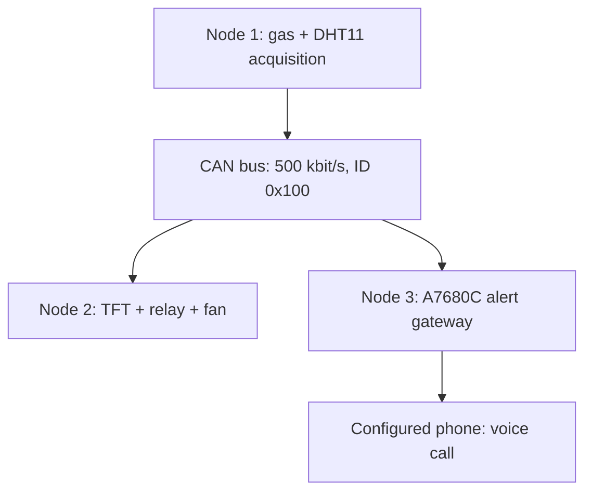

# CAN_RTOS — Distributed Gas Monitoring and Alert System

A three-node embedded prototype built with **STM32F103C8T6**, **FreeRTOS**, and **Classical CAN**. The system acquires gas, temperature, and humidity measurements; displays them on an ST7735 TFT; controls a 5 V fan through a relay; and places a cellular voice call when the gas ADC reading exceeds a configurable threshold.

**Repository:** [TranVanVinh74/CAN_RTOS](https://github.com/TranVanVinh74/CAN_RTOS)  
**Integrated firmware branch:** [`develop`](https://github.com/TranVanVinh74/CAN_RTOS/tree/develop)  
**Documented baseline:** [`d05a773`](https://github.com/TranVanVinh74/CAN_RTOS/commit/d05a773cc15e6543c37cc4e0096ceb47e60f437c) — `Verify three-node CAN system with relay and call alerts at ADC 2000`.

> This is an educational hardware prototype, not a certified gas detector or safety controller. Gas thresholds are raw ADC counts, not calibrated gas concentrations. The relay and voice-call functions have been tested on the developer's hardware; hardware-specific power and interface requirements still need to be checked for each build.

## Contents

- [System architecture](#system-architecture)
- [Implemented features](#implemented-features)
- [Hardware and development tools](#hardware-and-development-tools)
- [Repository layout](#repository-layout)
- [Electrical connections](#electrical-connections)
- [CAN protocol](#can-protocol)
- [Firmware and RTOS design](#firmware-and-rtos-design)
- [Thresholds and configuration](#thresholds-and-configuration)
- [Build and flash](#build-and-flash)
- [Bring-up and validation](#bring-up-and-validation)
- [Debug reference](#debug-reference)
- [Troubleshooting](#troubleshooting)
- [Git workflow](#git-workflow)
- [Known limitations and future work](#known-limitations-and-future-work)
- [References and licensing](#references-and-licensing)

## System architecture

Each node runs its own firmware on a separate STM32 board. All three nodes share one CAN bus, with one SN65HVD230 transceiver per node.



| Node | Role | Main interfaces | Current behavior |
|---|---|---|---|
| Node 1 | Sensor acquisition | ADC1, GPIO, TIM2, CAN1 | Samples gas, temperature, and humidity and broadcasts a four-byte CAN frame |
| Node 2 | Local display and actuation | CAN1, SPI1, GPIO | Displays sensor values and switches a relay on PB0 |
| Node 3 | Cellular alert gateway | CAN1, USART2 | Receives sensor values and places a timed voice call when the gas reading is high |

Node 2 and Node 3 independently evaluate the data broadcast by Node 1. **Node 3 does not command Node 2's relay in the current implementation.** An actuator-command frame such as ID `0x200` is not part of the integrated runtime protocol.

## Implemented features

- FreeRTOS tasks and queues on all three nodes.
- Gas acquisition through a 12-bit ADC with an eight-sample arithmetic average per acquisition.
- DHT11 temperature/humidity acquisition using TIM2 for microsecond timing.
- Sensor broadcasting approximately every 500 ms.
- Standard 11-bit Classical CAN data frames at 500 kbit/s.
- ST7735 color display, 128 × 160 pixels, RGB565.
- Relay control on Node 2 PB0 with configurable input polarity.
- Independent Node 3 voice-call alerts through a SIMCom A7680C modem.
- Latest-value buffering and a three-second freshness check on Node 3.
- A 60-second minimum interval between call attempts, including failed attempts.
- Runtime diagnostics exposed as global variables for Keil Watch.

The A7680C library also contains SMS helper functions. **The current integrated application uses voice calls and does not automatically send SMS.**

## Hardware and development tools

| Item | Quantity / purpose |
|---|---|
| STM32F103C8T6 board | Three; one for each node |
| SN65HVD230 CAN transceiver module | Three; one per STM32 CAN controller |
| Analog MQ-series gas sensor module | One; firmware driver is named `MQ5` |
| DHT11 module/sensor | One; temperature and humidity |
| ST7735 SPI TFT | One; 128 × 160 display |
| Relay module with a driver circuit | One channel; tested configuration uses an active-HIGH input |
| 5 V DC fan | One; switched by the relay contacts |
| SIMCom A7680C development board | One; tested modem identified as A7680C-LANS |
| Active SIM and cellular antenna | Required for outgoing calls |
| ST-Link | Firmware programming and SWD debugging |
| CH340 USB-to-UART adapter | Optional; direct modem diagnostics |
| Suitable power supplies | Sized for the sensor heater, relay, fan, and modem |

### Gas sensor naming

The source files are `MQ5.c` and `MQ5.h`. They implement analog ADC acquisition; they do not identify the connected sensor or convert its output into gas concentration. An MQ-2 module may also be connected during testing, but its sensing characteristics, supply requirements, and calibration are different. Confirm the actual hardware model rather than treating MQ-2 and MQ-5 as interchangeable calibrated instruments.

### Toolchain recorded in the projects

- Keil µVision / MDK-ARM.
- ARM Compiler **5.06 update 6, build 750**.
- Device pack **Keil.STM32F1xx_DFP 2.4.1**.
- STM32F1 HAL, CMSIS, and FreeRTOS sources included in the node directories.
- FreeRTOS Cortex-M3 port under `portable/RVDS/ARM_CM3`.

The checked-in projects target ARM Compiler 5. Switching to ARM Compiler 6 requires a toolchain/port compatibility review; changing the compiler selector alone is not a validated migration.

## Repository layout

| Path | Purpose |
|---|---|
| `Node1/Core/Src/main.c` | Acquisition tasks and CAN transmitter |
| `Node1/Core/Inc/` | Node 1 application and HAL configuration headers |
| `Node1/Lib/DHT11.c`, `DHT11.h` | DHT11 driver |
| `Node1/Lib/MQ5.c`, `MQ5.h` | ADC-based gas driver |
| `Node1/MDK-ARM/Node1.uvprojx` | Node 1 Keil project |
| `Node2/Core/Src/main.c` | CAN receiver, TFT rendering, relay logic |
| `Node2/Lib/TFT.c`, `TFT.h` | ST7735 driver |
| `Node2/Lib/FONT.c`, `FONT.h` | Bitmap font definitions |
| `Node2/MDK-ARM/Node2.uvprojx` | Node 2 Keil project |
| `Node3/Node3/Core/Src/main.c` | Integrated CAN/cellular gateway |
| `Node3/Node3/Core/Src/A7680C.c` | A7680C helper library |
| `Node3/Node3/Core/Inc/A7680C.h` | A7680C library interface |
| `Node3/Node3/MDK-ARM/Node3.uvprojx` | Node 3 Keil project |
| `WORKFLOW.md` | Earlier development workflow notes |

Each node also includes `Drivers`, `Middlewares`, CubeMX configuration, startup code, and HAL interrupt/timebase support. **Node 3 has a nested `Node3/Node3` directory; this is the actual project path.** Its modem library is under `Core/Src` and `Core/Inc`, not a separate `Lib` directory.

Some older README/workflow notes describe the initial skeleton stage. The integrated behavior documented here is tied to the baseline commit above.

## Electrical connections

Pin names below refer to the STM32 GPIO names. Check the silkscreen and schematic of the actual boards. Power-input ratings and UART input levels of development boards can differ from those of the bare components.

### CAN connections — all nodes

| STM32 | SN65HVD230 module |
|---|---|
| PA11 — CAN_RX | RXD / R, transceiver receiver output |
| PA12 — CAN_TX | TXD / D, transceiver driver input |
| 3.3 V | VCC / 3V3 |
| GND | GND |

Connect all transceivers to the same bus:

- CANH to CANH.
- CANL to CANL.
- Common ground reference between the nodes.
- Use a linear bus with short stubs.
- Fit one 120 Ω termination resistor across CANH/CANL at each physical end of the bus. With three nodes, the middle node must not add a third termination.
- Check whether the modules already contain termination resistors or jumpers.

With power removed, two 120 Ω end terminations in parallel should measure approximately 60 Ω across CANH/CANL, assuming no other circuit significantly affects the measurement.

Do not connect PA11/PA12 directly to CANH/CANL. The transceiver is required between the controller and the differential bus.

### Node 1 — sensors

| Signal | STM32 pin / resource |
|---|---|
| Gas module analog output, AO | PA1 / ADC1 channel 1 |
| DHT11 DATA | PA2 |
| DHT11 timing | TIM2, configured for a 1 MHz counter |
| CAN | PA11 RX, PA12 TX |

The ADC code uses the analog output, not the gas module's comparator output `DO`. Keep the ADC input within the STM32's permitted analog range. If the sensor module can output above that range, use a suitable divider/interface. Power its heater from the supply required by the actual sensor module; do not assume the STM32's 3.3 V output can power it.

Use a DHT11 data pull-up appropriate for a 3.3 V STM32 interface; some modules already include one. Warm up the gas sensor according to its hardware documentation before evaluating its baseline.

### Node 2 — ST7735 TFT

| TFT signal | STM32 connection in this baseline |
|---|---|
| SCK / SCL | PA5 / SPI1 SCK |
| SDA / MOSI | PA7 / SPI1 MOSI |
| CS | PB1 |
| A0 / DC | PB10 |
| RST / RES | **PB11** |
| GND | GND |
| VCC | 3.3 V on the tested display board |
| LED / BL | 3.3 V on the tested display board |

PA6 is configured as SPI1 MISO but is not needed for this write-only display connection. SPI1 uses mode 0, 8-bit transfers, software NSS, MSB first, and a divide-by-32 prescaler: 2.25 MHz with a 72 MHz SPI peripheral clock.

**PB0 is reserved for the relay in this integrated version.** Earlier standalone display tests used different reset wiring. Follow `Node2/Core/Inc/main.h` and `Node2/Lib/TFT.h` in the checked-out version; both currently select PB11 for TFT reset. The macros in `TFT.h` directly select GPIO bits, so changing only `main.h` is insufficient if the pin assignment is changed later.

### Node 2 — relay and 5 V fan

For a relay module with a 5 V supply and an input compatible with STM32 3.3 V logic:

| Connection | Destination |
|---|---|
| Relay DC+ / VCC | Positive 5 V supply |
| Relay DC− / GND | Supply ground and STM32 ground |
| Relay IN1 | **PB0** |
| Relay COM for channel 1 | Positive 5 V supply |
| Relay NO1 | Fan red / positive lead |
| Fan black / negative lead | Negative 5 V supply |
| Relay NC1 | Unused |

The same suitable 5 V supply can feed DC+ and COM. DC+ powers the relay board; COM feeds the switched load circuit. They are not automatically connected inside the module.

The current code uses **active-HIGH** control: PB0 HIGH commands ON, PB0 LOW commands OFF. Match the relay's H/L jumper or input circuit to this setting. A bare relay coil must not be connected directly to PB0; it needs a driver and coil transient suppression.

For a DC inductive load requiring a flyback diode, connect the diode across the load: cathode/striped end to fan positive at NO1, anode to fan negative. Select its ratings for the load. A diode already present on a relay board normally protects the relay coil, not the external fan. For a brushless fan with internal electronics, consult its manufacturer for the appropriate suppression arrangement.

### Node 3 — A7680C

| Signal | Connection |
|---|---|
| STM32 PA2 / USART2 TX | Modem-board RXD |
| STM32 PA3 / USART2 RX | Modem-board TXD |
| STM32 GND | Modem-board GND / supply reference |
| PB12 | Defined as PWRKEY, but not driven in the integrated application |
| PA9 / USART1 TX | Optional diagnostic UART output connection |
| PA10 / USART1 RX | Available USART1 RX |

USART2 uses **115200 baud, 8 data bits, no parity, 1 stop bit, no flow control**. The integrated code powers the modem manually using the board's button/automatic power circuit. It calls `A7680C_Init()` but does not call `A7680C_PowerOn()`; PB12 is left as an input.

Use a modem supply appropriate for the exact development board, with enough transient current capacity. Do not power the modem from the STM32's 3.3 V pin. The bare A7680C VBAT specification differs from boards that include regulators. Also confirm whether the board provides UART level shifting before connecting STM32 or CH340 signals directly.

Fit the antenna and an active SIM with outgoing voice service. Disconnect a CH340 adapter's TX/RX before attaching the STM32 to the same modem UART. Two transmitters must not drive the modem RX line simultaneously.

## CAN protocol

### Bus configuration

| Parameter | Value |
|---|---|
| Controller | STM32 CAN1 / bxCAN |
| Format | Classical CAN, standard 11-bit ID |
| Mode | Normal |
| Bitrate | 500 kbit/s |
| CAN peripheral clock | 36 MHz, derived from HSE 8 MHz and PLL ×9 |
| Prescaler | 4 |
| Synchronization segment | 1 time quantum |
| BS1 | 15 time quanta |
| BS2 | 2 time quanta |
| SJW | 1 time quantum |
| Automatic retransmission | Disabled |
| Automatic bus-off recovery | Disabled |

Bitrate calculation:

```text
36,000,000 / [4 × (1 + 15 + 2)] = 500,000 bit/s
```

### Sensor message — ID `0x100`

| Field | Value |
|---|---|
| Sender | Node 1 |
| Receivers | Node 2 and Node 3 |
| IDE | Standard |
| RTR | Data frame |
| DLC | 4 |
| Nominal application period | 500 ms |

| Byte | Meaning | Encoding |
|---|---|---|
| 0 | Temperature | Unsigned integer °C |
| 1 | Relative humidity | Unsigned integer % |
| 2 | Gas ADC high byte | Bits 15…8 |
| 3 | Gas ADC low byte | Bits 7…0 |

Gas reconstruction:

```c
gas_raw = ((uint16_t)data[2] << 8) | data[3];
```

Example payload for 26 °C, 52% RH, gas ADC 2100:

```text
ID: 0x100   DLC: 4   DATA: 1A 34 08 34
```

The gas field is carried as 16 bits, although the source ADC is 12 bits. No voltage conversion, ppm calibration, sensor-validity flag, sequence number, or acquisition timestamp is transmitted. Node 3 adds a local reception timestamp after receiving a frame.

The receivers currently accept all CAN IDs in the hardware filter and validate standard/data/ID/DLC fields in software. Invalid frames increment a diagnostic counter.

## Firmware and RTOS design

### Clock and timebases

The projects assume an external **8 MHz HSE** and use a **72 MHz system clock**. APB1 runs at 36 MHz. HAL timing uses **TIM4**; its ISR ultimately calls `HAL_IncTick()`. FreeRTOS uses **SysTick**. Node 1 additionally uses TIM2 for DHT11 pulse timing.

The CAN RX0 interrupt uses priority 5, matching `configLIBRARY_MAX_SYSCALL_INTERRUPT_PRIORITY = 5`. Keep interrupt priorities compatible with FreeRTOS when using `...FromISR()` APIs.

### Node 1

| Task | Priority | Stack depth | Function |
|---|---|---|---|
| `Task_Sensor` | 2 | 256 words | Gas acquisition and DHT11 reading, nominal 500 ms cadence |
| `Task_CAN_TX` | 3 | 256 words | Waits on the sensor queue and submits CAN frames |

The five-element queue carries `SensorData_t` between the tasks. The gas driver averages up to eight successful ADC samples per acquisition; this is a batch average, not a sliding moving-average window. ADC failures are exposed by driver diagnostics, and the driver retains the most recent valid gas value if all samples fail.

The DHT11 driver uses timer-based edge measurement and a critical section during timing-sensitive capture. Its wake/start delay yields to FreeRTOS. The application's 500 ms loop should be reviewed against the actual sensor's specified sampling interval.

### Node 2

Startup order is intentional:

1. Initialize HAL, clock, and GPIO; command relay OFF.
2. Initialize SPI1.
3. Initialize the TFT once and draw the waiting screen.
4. Initialize CAN and create the queue/task.
5. Start the scheduler; the task configures the CAN filter, starts CAN, and enables RX notifications.

The RX ISR decodes each valid frame and pushes it to a five-element queue. `Task_Actuator` runs at priority 2 with a 512-word stack. It applies the relay decision before drawing the updated sensor values. SPI errors do not bypass the relay update for a received sample.

The TFT displays temperature, humidity, gas ADC, the commanded fan state, and a CAN status message. `FAN: ON` is a GPIO command indication; there is no fan rotation or relay-contact feedback.

On a queue timeout, Node 2 retains its previous relay state. The current UI does not automatically replace an old `CAN RX OK` message with a stale-data warning.

### Node 3

`Task_Gateway` runs at priority 2 with a 512-word stack. CAN starts before the initial modem wait. The ISR writes samples into a **one-element overwrite queue**, keeping the newest reading rather than building a backlog during modem operations.

After an initial three-second modem allowance, the task retries AT readiness checks when necessary. Once ready, it evaluates fresh CAN data and services a call state machine. It sends `ATD<phone>;` to dial and `ATH` to end the call. It continues servicing CAN while monitoring the call; it does not block inside a 30-second call-wait loop.

AT probing and UART transmission still use bounded blocking HAL calls. This is not a fully asynchronous UART/DMA implementation.

Call attempts are limited to one per 60 seconds, measured from the start of each attempt. The 30-second limit includes call setup and ringing, not just answered conversation time. `OK` means a command was accepted; it is not evidence that the recipient answered.

## Thresholds and configuration

### Node 2 — `Node2/Core/Src/main.c`

```c
#define RELAY_ACTIVE_LOW    0
#define GAS_FAN_ON          2000U
#define GAS_FAN_OFF         2000U
```

Current relay decisions are **gas > 2000 → ON**, otherwise **OFF**, as implemented by `Relay_UpdateFromGas()`. That function uses `GAS_FAN_ON` and an unconditional `else`; `GAS_FAN_OFF` is presently defined but not used to implement hysteresis. Changing only the OFF constant does not create a second threshold.

`RELAY_ACTIVE_LOW = 0` selects HIGH-to-activate. Use `1` only for hardware that requires LOW-to-activate.

### Node 3 — `Node3/Node3/Core/Src/main.c`

```c
#define ALERT_PHONE             "<recipient phone number>"
#define GAS_ALERT_ON            2000U
#define GAS_ALERT_OFF           2000U
#define CAN_DATA_TIMEOUT_MS     3000U
#define CALL_DURATION_MS        30000U
#define CALL_INTERVAL_MS        60000U
#define AT_RETRY_INTERVAL_MS    2000U
```

Replace `ALERT_PHONE` with an authorized recipient before deployment. The checked-in application already contains the developer's test destination; inspect it before powering the integrated system. Repeated high readings can initiate real, chargeable calls.

Automatic calls require all of the following:

1. AT readiness has been established.
2. At least one valid sensor frame has arrived.
3. The most recent frame is no older than 3000 ms.
4. The gas reading is greater than `GAS_ALERT_ON` and the alarm flag is set.
5. No call is currently being monitored.
6. The minimum interval since the previous attempt has elapsed.

The alarm flag is set above 2000 and cleared below 2000. At exactly 2000 it retains its previous value, but the separate `gas_raw > GAS_ALERT_ON` gate prevents a new automatic call. Stale data also prevents new automatic calls; it does not cancel a call already in progress.

Node 1 does not need a threshold edit because it only sends measurements. When changing the system threshold, update both receiver applications and flash Node 2 and Node 3.

## Build and flash

### 1. Get the integrated firmware

```bash
git clone --branch develop https://github.com/TranVanVinh74/CAN_RTOS.git
cd CAN_RTOS
git branch --show-current
```

For an existing checkout with a clean working tree:

```bash
git switch develop
git pull --ff-only origin develop
```

`--ff-only` allows an update only when Git can fast-forward without creating a merge commit. It is unrelated to the old repository named `ff`.

### 2. Open the matching Keil project

| Board | Project |
|---|---|
| Node 1 | `Node1/MDK-ARM/Node1.uvprojx` |
| Node 2 | `Node2/MDK-ARM/Node2.uvprojx` |
| Node 3 | `Node3/Node3/MDK-ARM/Node3.uvprojx` |

Select the recorded ARM Compiler 5 toolchain and install the corresponding STM32F1 device pack. Check source/include entries if libraries were moved locally. `TFT.c`, `FONT.c`, and `A7680C.c` must be included in their corresponding projects.

### 3. Build and program each board

1. Connect ST-Link SWDIO, SWCLK, and GND to the intended board; provide board power and the reference/reset connections required by the probe.
2. Select the intended ST-Link and SWD interface in the project's Debug settings.
3. Rebuild the target and resolve all compilation/link errors.
4. Download the firmware and check the programming result.
5. Run the board; repeat using the correct project for each node.

Each node has its own executable. Copying source into one Git branch does not combine the three MCUs into a single flash image. Switching Git branches also does not change firmware already programmed into a board.

Keep all nodes running during communication tests. Halting a node in the debugger can affect reception, acknowledgement, alert timing, and the state of an already commanded relay/call.

## Bring-up and validation

The developer reported successful hardware tests of sensor acquisition, Node 1-to-Node 2 CAN reception, TFT display, standalone modem calling, integrated Node 3 alerts, and PB0 relay control. These are manual prototype tests, not an automated certification or endurance test suite.

### Stage 1 — Node 1 sensors

- Inspect `g_sensorDebug` for temperature, humidity, and gas ADC readings.
- Inspect `g_mq5Error` and `g_mq5ReadErrors` for ADC driver failures.
- Allow sensor warm-up; record the baseline in the actual environment.
- A changing sensor debug value alone does not confirm successful CAN transmission.

### Stage 2 — Node 1 and Node 2

- Connect the two transceivers with correct polarity and termination.
- Run both boards.
- Expect the TFT waiting screen before reception, then `CAN RX OK` and sensor values.
- Verify that `g_canRxCount` and `g_canProcessedCount` increase.
- Compare Node 2 values with Node 1's transmitted values.

### Stage 3 — modem directly through CH340

Use a UART adapter with compatible logic levels. Disconnect STM32 UART signals during this test. Select 115200 baud, 8N1, no flow control, and CR+LF line endings.

Send one command at a time:

```text
AT
ATI
AT+CPIN?
AT+CSQ
```

Expect `OK` for AT and `+CPIN: READY` for an accessible SIM. Signal-quality information alone does not prove network registration or voice service availability.

To place an intentional test call, substitute the recipient number:

```text
ATD<recipient phone number>;
```

To hang up:

```text
ATH
```

If a command fails, enable detailed errors with `AT+CMEE=2` and retain the exact response. `AT+CREG?` and `AT+CEREG?` returned `ERROR` during one direct test even though an outgoing voice call later worked; the integrated application therefore does not require those queries to succeed before calling.

### Stage 4 — all three CAN nodes

- Restore STM32-to-modem wiring and power on the modem.
- Add Node 3 to the bus; retain termination only at the two physical ends.
- Verify `g_node3Debug` agrees with the other nodes and `g_sensorFresh = 1`.
- To isolate the call path, set `g_callRequest = 1` in Watch and resume execution. This manual request respects cooldown but does not require a high gas value or fresh CAN data.
- Set `g_hangupRequest = 1` for early hang-up while the call is active.

### Stage 5 — integrated threshold and relay test

Use controlled test input or temporarily adjusted software thresholds; do not release flammable gas to demonstrate the system.

| Test condition | Expected result |
|---|---|
| Gas ≤ 2000 | Node 2 commands relay OFF |
| Gas > 2000 | Node 2 commands relay ON |
| Fresh gas > 2000, modem ready, cooldown complete | Node 3 starts a call attempt |
| High gas persists | Another attempt becomes eligible after at least 60 seconds |
| Node 1 disconnected for more than 3 seconds | Node 3 stops initiating automatic calls from the old reading |
| CAN stops while relay is ON | Node 2 retains relay ON in the current firmware |
| Modem reports BUSY/NO CARRIER/NO ANSWER | Call monitoring ends; this does not mean a person answered |

Confirm physical fan behavior as well as TFT/Watch values. If `FAN: OFF` corresponds to a spinning fan, check COM/NO wiring and relay input polarity before modifying CAN code.

## Debug reference

### Node 1

| Variable | Meaning |
|---|---|
| `g_sensorDebug` | Last application sensor values |
| `g_mq5Error` | Gas ADC driver error code |
| `g_mq5ReadErrors` | Accumulated ADC acquisition failures |

Some other diagnostic variables exist in Node 1 but are not actively incremented by the current task code. Do not use their unchanged values as proof that the application is stopped.

### Node 2

| Variable | Meaning |
|---|---|
| `g_node2Debug` | Last processed sensor sample and commanded fan state |
| `g_canStage` | 0 not started; 1 starting; 2 reception enabled |
| `g_canRxCount` | Valid sensor frames decoded by the ISR |
| `g_canProcessedCount` | Samples consumed by the task |
| `g_canQueueFullCount` | Queue sends rejected because the queue was full |
| `g_canInvalidCount` | Frames rejected by protocol validation |
| `g_canReadErrorCount` | HAL FIFO read failures |
| `g_canError` | Last sampled HAL CAN error flags |
| `g_tftStage` | 1 initializing; 2 waiting UI; 3 values drawn; 99 SPI error |
| `g_tftSPIErrors` | Latched SPI transmission failure count |
| `g_tftSPIStatus`, `g_tftSPIHalError` | SPI diagnostic details |
| `g_relayState` | Commanded state: 0 OFF, 1 ON |
| `g_relayPinLevel` | PB0 output latch level, not contact feedback |
| `g_relaySwitchCount` | Changes in the commanded relay state |
| `g_errorCode` | Fatal initialization/allocation/startup error |

### Node 3

| Variable | Meaning |
|---|---|
| `g_node3Debug` | Latest processed sample and local reception time |
| `g_canStage`, `g_canRxCount`, `g_canProcessedCount` | CAN startup/reception/application progress |
| `g_canInvalidCount`, `g_canReadErrorCount`, `g_canQueueErrorCount` | CAN/queue diagnostics |
| `g_sensorSeen`, `g_sensorFresh`, `g_sensorAgeMs` | Data availability and age |
| `g_gasAlarm` | Latched threshold flag; not the complete call-eligibility decision |
| `g_atOK`, `g_atFailCount` | Modem AT readiness and failed checks |
| `g_callStage` | Call state; see table below |
| `g_callActive` | A call attempt is currently being monitored |
| `g_callAttempts` | Number of attempts, not answered calls |
| `g_callElapsedMs`, `g_callCooldownMs` | Call monitoring time and remaining cooldown |
| `g_callRequest`, `g_hangupRequest` | Manual debug requests |
| `g_callRx`, `g_lastCommand` | Modem response text and last transmitted command |
| `g_uartTxStatus`, `g_uartError` | HAL UART diagnostics |
| `g_errorCode` | Fatal startup error |

| `g_callStage` | Meaning |
|---|---|
| 0 | Task not started |
| 1 | Initial modem allowance |
| 2 | Checking AT |
| 3 | AT readiness established |
| 4 | Sending dial command |
| 5 | Monitoring the call |
| 6 | Hang-up command transmitted |
| 7 | Modem reported call termination |
| 90 | UART transmit failure or modem ERROR response |

Stage 6 indicates that `ATH` was transmitted; the application does not separately validate the final hang-up response. Stage 3 records an AT readiness result, not confirmation of ongoing network registration.

## Troubleshooting

| Symptom | Checks |
|---|---|
| All CAN counters stay at zero | Check startup stage, whether both boards are running, bus wiring/termination, bit timing, and RX interrupt delivery |
| Sensor values change on Node 1 but no reception elsewhere | Check transmitter HAL status and CAN error state; sensor acquisition does not prove frame delivery |
| Invalid-frame count increases | Check standard vs extended ID, RTR, ID `0x100`, and exact DLC 4 |
| TFT shows only `WAIT CAN...` | Initial TFT setup completed; inspect CAN startup/RX/processed counters before changing the display driver |
| TFT blank with no SPI error | Verify exact TFT control pins, reset, backlight, and init configuration; HAL SPI success does not prove the display accepted data |
| Relay behavior is inverted | Check COM–NO rather than COM–NC, input H/L selector, and `RELAY_ACTIVE_LOW` |
| Relay chatters near the threshold | Both applications use a single effective threshold; add deliberate hysteresis/debounce if required |
| AT works through CH340 but not STM32 | Verify crossed TX/RX, common ground, UART logic levels, baud rate, modem power, and only one transmitter on RXD |
| AT responds but no call occurs | Check recipient, SIM voice service, modem/network state, freshness, gas condition, and cooldown; inspect `g_callRx` |
| Call setup takes several seconds | Initial modem allowance, AT retries, and network setup/ringing all contribute |
| Debug repeatedly appears at startup | Distinguish source highlighting from actual execution; inspect PC/reset behavior and debugger configuration, then compare with known-good hardware |

During development, one board exhibited startup/debug problems that disappeared after replacing the MCU/board. This is a useful hardware-isolation observation, not evidence that every `HAL_Init()` symptom has the same cause.

## Git workflow

| Branch | Purpose |
|---|---|
| `main` | Landing/release branch; integrated firmware has not been promoted here as part of this baseline |
| `develop` | Current integrated firmware baseline |
| `feature/can-three-nodes` | Three-node integration work; same head as `develop` at the documented baseline |
| `feature/can-node1-node2` | Earlier Node 1/Node 2 CAN and TFT work |
| `feature/hal-timer-adc` | Sensor/timer/ADC development |
| `feature/hal-i2c-spi` | Display-driver development stage |
| `feature/hal-gpio-uart` | Modem/UART development and standalone calling test |
| `setup/project-skeleton` | Initial project skeleton |
| `backup/full-code` | Historical source backup |

Use a feature branch for new functionality:

```bash
git switch develop
git pull --ff-only origin develop
git switch -c feature/your-change
```

After building and hardware validation, stage specific files and inspect the diff:

```bash
git add path/to/changed/source.c
git diff --cached
git commit -m "Describe the tested behavior"
git push -u origin feature/your-change
```

Merge reviewed/tested work into `develop`. Promote an explicitly approved stable release into `main` later. Adding a README or merging a feature does not freeze a branch; subsequent commits can still be pushed.

Keil may change `.uvprojx`, RTE files, and local debug artifacts. Review project changes: source entries and include paths may be essential, whereas personal debugger settings and build outputs generally are not. Preserve uncommitted changes with a targeted stash or commit before switching branches; do not discard them blindly.

Each branch is a snapshot of the entire repository, including all three nodes. Changing which Keil project you open does not require changing Git branches. Re-checkout feature branches only when intentionally selecting their earlier firmware state.

## Known limitations and future work

1. **Gas calibration:** raw ADC thresholds depend on sensor type, heater warm-up, supply, divider ratio, environment, and calibration. No ppm conversion or certified alarm threshold is implemented.
2. **Freshness is reception-based:** Node 3 timestamps received frames. A transmitter can repeatedly send a retained sensor value after a sensor failure; the packet currently has no sensor-validity bit to expose that distinction.
3. **Node 1 DHT failure handling:** the local sensor struct is not initialized before the loop. A failed first DHT reading can leave temperature/humidity undefined; later failures retain previous values. Initialize it and transmit validity information in a future revision.
4. **Node 1 error checks:** queue/task creation and several CAN HAL results are not checked in the current application. Add explicit status counters and recovery behavior.
5. **CAN recovery:** automatic retransmission and bus-off recovery are disabled. Robust deployment needs a reviewed error-handling/recovery policy.
6. **Node 2 communication loss:** relay state is retained and the TFT can continue displaying old values. Define an intentional communication-loss policy and stale-data indication before broader deployment.
7. **Threshold noise:** no effective hysteresis/debounce is currently applied to Node 2 relay switching. ADC noise around 2000 can produce repeated switching.
8. **Call confirmation:** there is no `AT+CLCC`-based answered-call tracking, delivery acknowledgement, or spoken alert playback. A dial attempt is not proof that the recipient received the warning.
9. **Modem recovery:** AT readiness is not continuously revalidated after an initial success, and hang-up completion is not explicitly confirmed. Reset detection and recovery can be improved.
10. **Scheduling:** UART operations and display writes use polling/bounded blocking calls. Measure stack usage, queue occupancy, and worst-case task latency before expanding functionality.
11. **Actuator feedback:** PB0 and TFT state represent commands only. There is no fan tachometer, current measurement, or relay-contact feedback.
12. **CubeMX regeneration:** application code contains manual task/driver changes. Review regenerated files carefully; the `.ioc` skeleton does not fully represent every integrated application decision.

Potential next steps include sensor-validity flags and sequence numbers in the CAN payload, configurable thresholds, calibrated gas conversion, relay debounce, modem call-status tracking, SMS escalation, and explicit fault-state handling.

## References and licensing

- [Project repository](https://github.com/TranVanVinh74/CAN_RTOS)
- [STM32F103C8 product information](https://www.st.com/en/microcontrollers-microprocessors/stm32f103c8.html)
- [FreeRTOS documentation](https://www.freertos.org/Documentation/)
- [TI SN65HVD230 product information and datasheet](https://www.ti.com/product/SN65HVD230)
- [SIMCom A7680C product information](https://cn.simcom.com/product/A7680C.html)
- [Keil µVision documentation](https://www.keil.com/support/man/docs/uv4/)

Third-party HAL, CMSIS, FreeRTOS, and vendor files retain their own copyright and license terms. No repository-wide application license is declared at the documented baseline; this README does not grant additional rights to the application code.
