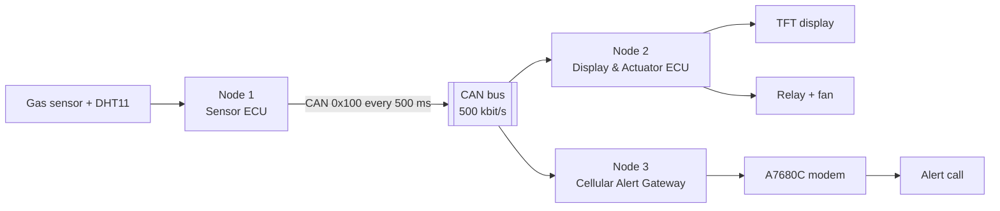

# Distributed CAN Monitoring and Central Alert System (Automotive CAN Gateway)

Three STM32 ECUs on one CAN bus, coordinated by FreeRTOS, that monitor gas, temperature and humidity, drive a ventilation fan and raise alerts over the cellular network.

A sensor ECU broadcasts its readings on the bus. A display and actuator ECU shows them on a TFT and switches the fan; a cellular gateway calls a phone when the gas level is too high. Each receiving ECU decides on its own from the same frame, so no node depends on another to act.

This is a prototype: gas is a raw ADC reading, not a calibrated concentration, and the system is not a certified gas detector.

## System overview

| ECU | Role |
|---|---|
| Node 1 · Sensor ECU | Reads the MQ-5 gas sensor and DHT11, broadcasts one frame every 500 ms |
| Node 2 · Display & Actuator ECU | Shows readings and fan state on an ST7735 TFT, switches the fan with hysteresis (on above 2000, off below 1800) |
| Node 3 · Cellular Alert Gateway | Checks that data is fresh, raises the alarm with the same hysteresis (on above 2000, off below 1800), calls a phone through the A7680C modem, limits call rate and length |

## Features

- STM32F103C8T6 ECUs running FreeRTOS, linked by Classical CAN at 500 kbit/s.
- Interrupt-driven CAN reception feeding FreeRTOS queues; slow work (display, modem) stays in tasks.
- Automatic ventilation from the gas threshold, with hysteresis.
- Cellular VoLTE call alert with freshness check, 60 s minimum interval between calls and 30 s call limit.
- Modem replies received by interrupt into a ring buffer, so a rejected call or a modem restart ends the call at once.
- Stack overflow checking and a fatal error code on every node.

## Repository structure

| Folder | Content |
|---|---|
| `common/` | `can_protocol.h`: the only definition of the CAN frame, shared by all nodes |
| `node1-sensor/` | Sensor ECU firmware |
| `node2-actuator/` | Display & actuator ECU firmware |
| `node3-gateway/` | Cellular alert gateway firmware |

Each node folder is an STM32CubeIDE project with the same layers:

| Folder | Content |
|---|---|
| `Core/`, `Drivers/`, `Middlewares/` | Generated by STM32CubeMX: `main.c`, interrupts, STM32 HAL, CMSIS, FreeRTOS |
| `bsp/` | Board pin mapping, start-up error codes, `bsp_board_init()` |
| `hal/` | Device drivers on top of STM32 HAL (sensors, TFT, relay, modem, CAN) |
| `app/` | FreeRTOS tasks, queues and application logic; `app_cfg.h` holds priorities, stack sizes and thresholds |

`main.c` only initialises the board, creates the queues and tasks, and starts the scheduler.

## Getting started

Hardware: three STM32F103C8T6 boards with SN65HVD230 CAN transceivers, an MQ-5 gas sensor, a DHT11, an ST7735 TFT, a relay with a 5 V fan, a SIMCom A7680C modem with SIM, and an ST-Link V2.

1. Install STM32CubeIDE 1.18.1 and import the three projects with **File → Import → Existing Projects into Workspace**.
2. Copy `node3-gateway/app/inc/app_secrets.example.h` to `app_secrets.h` in the same folder and set `APP_ALERT_PHONE` to the number that should receive alerts. `app_secrets.h` is ignored by git.
3. Build each project and flash it to its board with the ST-Link.

Wire the CAN bus as a line Node 1 – Node 2 – Node 3, with 120 Ω only at Node 1 and Node 3. Power the modem from its own 5 V supply rated for at least 2 A, with a ground shared with Node 3, and use a SIM that supports VoLTE. Do not regenerate code from the `.ioc` files yet: some `main.c` initialisation still sits outside the `USER CODE` blocks.

## Limitations

- If CAN data stops, the fan keeps its last state.
- Thresholds are fixed at build time; setting them from a diagnostic tool is planned.
- Node 3 calls one number and does not retry or fall back to SMS when a call fails.

## License

The firmware written for this project is released under the MIT License (see `LICENSE`). STM32 HAL, CMSIS and FreeRTOS keep their own licenses, included in their folders.
