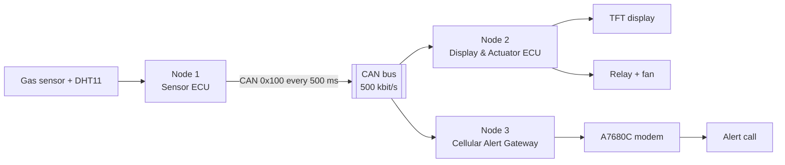

# Distributed CAN Monitoring and Central Alert System (Automotive CAN Gateway)

Three STM32 ECUs on one CAN bus, coordinated by FreeRTOS, that monitor gas, temperature and humidity, drive a ventilation fan and raise alerts over the cellular network.

A sensor ECU broadcasts its readings on the bus. A display and actuator ECU shows them on a TFT and switches the fan; a cellular gateway calls a phone when the gas level is too high. Each receiving ECU decides on its own from the same frame, so no node depends on another to act.

This is a prototype: gas is a raw ADC reading, not a calibrated concentration, and the system is not a certified gas detector.

## System overview

| ECU | Role |
|---|---|
| Node 1 · Sensor ECU | Reads the MQ-5 gas sensor and DHT11, broadcasts one frame every 500 ms |
| Node 2 · Display & Actuator ECU | Shows readings and fan state on an ST7735 TFT, turns the fan on when gas exceeds the threshold |
| Node 3 · Cellular Alert Gateway | Checks that data is fresh, calls a phone through the A7680C modem, limits call rate and length |

## Features

- STM32F103C8T6 ECUs running FreeRTOS, linked by Classical CAN at 500 kbit/s.
- Interrupt-driven CAN reception feeding FreeRTOS queues; slow work (display, modem) stays in tasks.
- Automatic ventilation from the gas threshold.
- Cellular voice alert with freshness check, 60 s minimum interval between calls and 30 s call limit.

## Repository structure

| Folder | Content |
|---|---|
| `node1-sensor/` | Sensor ECU firmware |
| `node2-actuator/` | Display & actuator ECU firmware |
| `node3-gateway/` | Cellular alert gateway firmware |

Each folder is an STM32CubeIDE project with its STM32CubeMX `.ioc` file, STM32 HAL and FreeRTOS.

## Getting started

Hardware: three STM32F103C8T6 boards with SN65HVD230 CAN transceivers, an MQ-5 gas sensor, a DHT11, an ST7735 TFT, a relay with a 5 V fan, a SIMCom A7680C modem with SIM, and an ST-Link V2.

1. Install STM32CubeIDE 1.18.1 and import the three projects with **File → Import → Existing Projects into Workspace**.
2. Set `ALERT_PHONE` in Node 3's `main.c` to the number that should receive alerts.
3. Build each project and flash it to its board with the ST-Link.

Terminate the CAN bus with 120 Ω at both ends. Do not regenerate code from the `.ioc` files yet: `main.c` still holds tested changes outside the `USER CODE` blocks.

## Limitations

- One threshold for on and off, so the fan can chatter around it.
- If CAN data stops, the fan keeps its last state.
- Node 3 misses most modem replies, so every call runs to the 30 s limit.

## License

The firmware written for this project is released under the MIT License (see `LICENSE`). STM32 HAL, CMSIS and FreeRTOS keep their own licenses, included in their folders.
