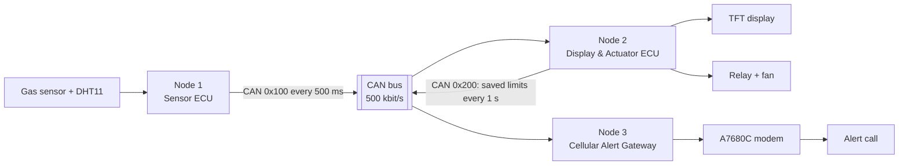

# Distributed CAN Monitoring and Central Alert System (Automotive CAN Gateway)

Three STM32 ECUs on one CAN bus, coordinated by FreeRTOS, that monitor gas, temperature and humidity, drive a ventilation fan and raise alerts over the cellular network.

A sensor ECU broadcasts its readings on the bus. A display and actuator ECU shows them on a TFT and switches the fan; a cellular gateway calls a phone when gas or temperature exceeds its configured limit. Each receiving ECU decides on its own from the same sensor frame. Node 2 supplies shared limits; Node 3 can use defaults or its last received limits when Node 2 is unavailable.

This is a prototype: gas is a raw ADC reading, not a calibrated concentration, and the system is not a certified gas detector.

## System overview

| ECU | Role |
|---|---|
| Node 1 · Sensor ECU | Reads the MQ-5 gas sensor and DHT11, broadcasts one frame every 500 ms |
| Node 2 · Display & Actuator ECU | Shows the ST7735 instrument cluster, edits and stores gas/temperature limits, broadcasts committed limits and controls the fan with hysteresis |
| Node 3 · Cellular Alert Gateway | Receives limits, checks sensor freshness, evaluates the same gas/temperature hysteresis and calls through the A7680C with rate and duration limits |

## Features

- STM32F103C8T6 ECUs running FreeRTOS, linked by Classical CAN at 500 kbit/s.
- Interrupt-driven CAN reception feeding FreeRTOS queues; slow work (display, modem) stays in tasks.
- With both sensors valid, gas or temperature above its configured limit activates ventilation and the call alarm. Both gas below its limit minus 200 raw ADC counts and temperature below its limit minus 2 °C clear the alarm; equality holds the previous state.
- Animated TFT cluster: start-up sweep and lamp check, smooth gauge movement, blinking danger lamp, OFFLINE after 3 s without processed sensor data, BUS ERROR from live CAN state, with automatic bus-off recovery on Node 2; only changed regions are redrawn. Gas is shown as a percentage of the alarm threshold (the MQ-5 is not calibrated, so no ppm), the raw reading in the settings screen.
- Four active-low buttons on Node 2: PB12 SELECT opens settings and selects a limit, PB13 PLUS increases it, PB14 MINUS decreases it, PB15 SAVE stores changed limits in flash and exits. Gas limits range from 500 to 3800 raw ADC counts in steps of 50; temperature limits range from 30 to 50 °C in steps of 1 °C. Each press produces one event after debounce; holding a button does not repeat.
- Node 2 restores saved limits at boot. Its final 1 KB flash page is reserved for a versioned record with CRC32; an empty or invalid record falls back to gas 2000 and temperature 40 °C. SAVE without changes skips the flash write; a write failure keeps SETTINGS open and shows SAVE FAILED.
- Node 2 sends committed limits in standard CAN frame `0x200` (3 bytes: gas high byte, gas low byte, temperature) at startup, after a changed SAVE and every 1 s. Node 3 retains the last valid limits in RAM, using 2000/40 °C before the first valid frame. Settings edits remain drafts until SAVE succeeds.
- Sensor frame `0x100` has 5 bytes: temperature, humidity, gas high byte, gas low byte, error flags (bit 0: MQ-5 ADC read failure; bit 1: DHT11 read failure; other bits must be zero). Failed readings are hidden as `--` on the TFT with SENSOR ERROR unless a valid reading requires DANGER. During a sensor fault, only a valid reading above its limit can trigger a call; the fan can turn on but holds its state until both sensors recover and confirm values below the off limits.
- Cellular VoLTE call alert with freshness check, 60 s minimum interval between call attempts and a 30 s call timeout.
- Modem replies received by interrupt into a ring buffer; call-end and restart indications update the call state when received. Rejection without a call-end indication is handled by the 30 s call timeout.
- Automatic calls request hang-up when the alarm clears or sensor data becomes stale. Manual debug calls keep their existing timeout/hang-up behavior.
- Stack overflow hooks on all nodes; Node 2 and Node 3 also expose fatal start-up error codes.

## Repository structure

| Folder | Content |
|---|---|
| `common/` | `can_protocol.h`: shared wire definitions; `alert_thresholds.h`: shared limit validation and hysteresis; `sensor_status.h`: error flags and valid-reading policies |
| `node1-sensor/` | Sensor ECU firmware |
| `node2-actuator/` | Display & actuator ECU firmware |
| `node3-gateway/` | Cellular alert gateway firmware |

Each node folder is an STM32CubeIDE project with the same layers:

| Folder | Content |
|---|---|
| `Core/`, `Drivers/`, `Middlewares/` | Generated by STM32CubeMX from the `.ioc` file: `main.c`, interrupts, STM32 HAL, CMSIS, FreeRTOS. Project code in `Core/` lives only inside `USER CODE` blocks, so the code can be regenerated |
| `bsp/` | Board pin mapping, start-up error codes, `bsp_board_init()` |
| `hal/` | Device drivers on top of STM32 HAL (sensors, TFT, relay, modem, CAN) |
| `app/` | FreeRTOS tasks, queues and application logic; `app_cfg.h` holds priorities, stack sizes and thresholds |

`main.c` only initialises the board, creates the queues and tasks, and starts the scheduler.

## Getting started

Hardware: three STM32F103C8T6 boards with SN65HVD230 CAN transceivers, an MQ-5 gas sensor, a DHT11, an ST7735 TFT, a relay with a 5 V fan, four push buttons, a SIMCom A7680C modem with SIM, and an ST-Link V2.

1. Install STM32CubeIDE 1.18.1 and import the three projects with **File → Import → Existing Projects into Workspace**.
2. Copy `node3-gateway/app/inc/app_secrets.example.h` to `app_secrets.h` in the same folder and set `APP_ALERT_PHONE` to the number that should receive alerts. `app_secrets.h` is ignored by git.
3. Build each project and flash it to its board with the ST-Link.

Wire the CAN bus as a line Node 1 – Node 2 – Node 3, with 120 Ω only at Node 1 and Node 3. Power the modem from its own 5 V supply rated for at least 2 A, with a ground shared with Node 3, and use a SIM that supports VoLTE.

Connect each Node 2 button between its GPIO (PB12–PB15) and GND. The GPIOs use internal pull-ups, so no external pull-up or 5 V connection is needed.

## Limitations

- If CAN data stops, the fan keeps its last state.
- Error flags report driver read failures. An unplugged MQ-5 analog wire can still produce successful ADC conversions and is not reliably detected by these flags. Firmware using the former 4-byte sensor frame is incompatible; update all three nodes together.
- Automatic CAN bus-off recovery is enabled only on Node 2. Node 1 and Node 3 have no application recovery path for bus-off.
- There is no threshold acknowledgement or config expiry. Node 3 retains its last valid limits if Node 2 disappears; rebooting Node 3 restores defaults until the next valid threshold frame. Sensor freshness is tracked separately.
- Settings use one flash page: a power interruption during erase/write can discard the previous settings, in which case boot uses defaults. Mass erase or firmware that uses that page can also remove settings.
- Node 3 calls one number and does not retry or fall back to SMS when a call fails.
- The call timeout sends `ATH` once; a failed hang-up is not retried, and modem termination is not confirmed before clearing the active call state.

## Branches

| Branch | Content |
|---|---|
| `main` | Stable releases tested on the hardware, tagged `vX.Y.Z` |
| `develop` | Integration of finished features before the next release |
| `feature/*`, `integration/*` | Work in progress, merged into `develop` |

## License

The firmware written for this project is released under the MIT License (see `LICENSE`). STM32 HAL, CMSIS and FreeRTOS keep their own licenses, included in their folders. The fonts (Noto Sans, SIL Open Font License 1.1) and icons (Material Symbols, Apache License 2.0) drawn on the Node 2 display are listed with their licenses in `THIRD_PARTY.md`.
