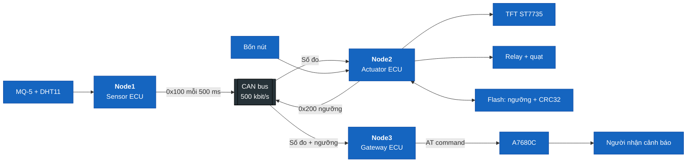
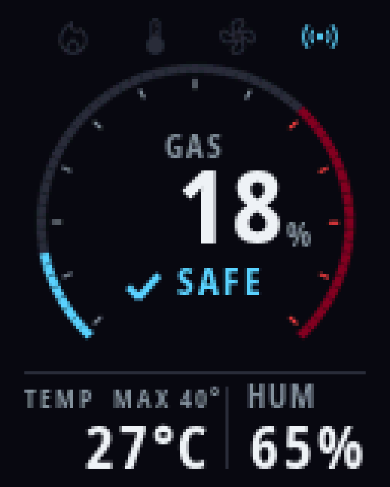
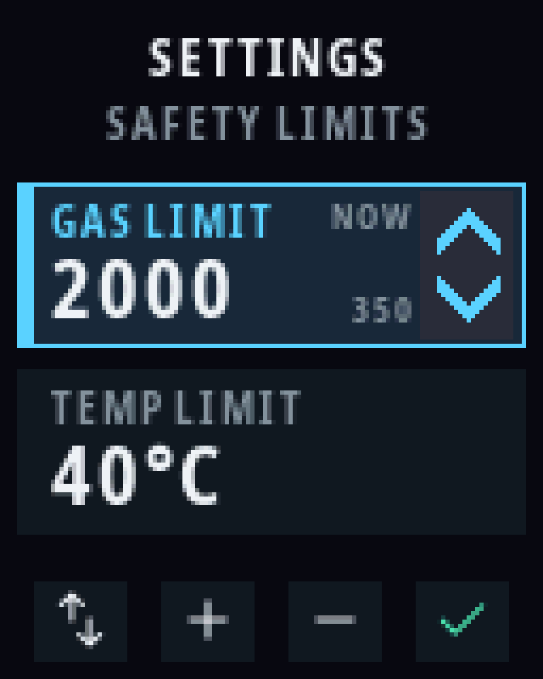

# Automotive CAN Gateway

Hệ thống giám sát gas, nhiệt độ và độ ẩm gồm ba node STM32 chạy FreeRTOS, giao tiếp qua CAN bus.

## Giới thiệu

Ba board STM32F103C8T6 nối chung một Classical CAN bus 500 kbit/s:

| Node | Vai trò | Thiết bị |
|---|---|---|
| **Node1 · Sensor ECU** | Đọc cảm biến, phát số đo mỗi 500 ms | MQ-5, DHT11 |
| **Node2 · Actuator ECU** | Hiển thị, chỉnh và lưu ngưỡng, bật quạt | TFT ST7735, bốn nút, relay |
| **Node3 · Gateway ECU** | Gọi điện cảnh báo | Modem A7680C + SIM |

Tính năng chính:
- Quạt và cuộc gọi bật khi gas **hoặc** nhiệt độ vượt ngưỡng, tắt khi **cả hai** về dưới ngưỡng tắt.
- Chỉnh ngưỡng bằng bốn nút, lưu vào flash có CRC32, đồng bộ sang Node3 qua CAN.
- Phát hiện lỗi cảm biến, mất Node1 (OFFLINE) và lỗi CAN (BUS ERROR).
- Node3 chỉ gọi từ dữ liệu fresh, giới hạn tần suất gọi, tự cúp máy và nhận ra khi modem reset.

## Kiến trúc

1. **Node1 chỉ phát số đo, consumer tự quyết định.** Node1 không biết ngưỡng. Node2 và Node3 tự quyết quạt và cuộc gọi từ cùng số đo, không gửi lệnh cho nhau. Node2 giữ ngưỡng và phát lại cho Node3; mặc định, range và hysteresis dùng chung trong `common/` nên hai node không lệch nhau.
2. **ISR nhanh, task chậm, nối bằng queue.** CAN RX ISR chỉ kiểm, giải mã frame rồi đẩy vào queue. Đọc cảm biến, vẽ TFT và giao tiếp modem nằm trong task.
3. **Mỗi consumer giữ dữ liệu theo nhu cầu.** Node2 xử lý từng số đo qua queue 5 phần tử. Node3 chỉ cần giá trị mới nhất nên dùng queue 1 phần tử ghi đè, gắn thời điểm nhận trong ISR để kiểm freshness.



## Phần cứng

| Linh kiện | Số lượng | Dùng ở |
|---|---:|---|
| STM32F103C8T6 | 3 | Mỗi node một board |
| Transceiver CAN SN65HVD230 | 3 | Mỗi node một module |
| Điện trở 120 Ω | 2 | Termination ở hai đầu bus |
| Cảm biến gas MQ-5 + cầu chia áp | 1 | Node1 |
| DHT11 | 1 | Node1 |
| TFT ST7735 128 × 160 (SPI) | 1 | Node2 |
| Module relay active-HIGH + quạt 5 V | 1 | Node2 |
| Nút nhấn | 4 | Node2 |
| Modem A7680C + SIM, nguồn 5 V ≥ 2 A | 1 | Node3 |
| ST-Link V2 | 1 | Nạp firmware |

| Node | Module | Chân STM32 |
|---|---|---|
| Node1 | MQ-5 | AO qua cầu chia áp về mức 3,3 V → PA1 |
| Node1 | DHT11 | DATA → PA2 |
| Node2 | ST7735 | SCK → PA5, MOSI/SDA → PA7, CS → PB1, DC/A0 → PB10, RST → PB11 |
| Node2 | Relay | IN → PB0 |
| Node2 | Nút (active-low, internal pull-up) | PB12 SELECT, PB13 PLUS, PB14 MINUS, PB15 SAVE; nối GPIO với GND |
| Node3 | A7680C · USART2 | Modem TX → PA3, modem RX → PA2 |
| Cả ba | SN65HVD230 | CTX → PA12, CRX → PA11; CANH, CANL và GND nối chung |

Bus nối theo tuyến Node1 – Node2 – Node3, termination đặt ở Node1 và Node3. Modem cần nguồn riêng đủ dòng, GND chung với Node3; nguồn yếu làm modem reset khi nối máy.

## Bắt đầu

Cần `arm-none-eabi-gcc`, `make`, `st-flash` (stlink) và `xxd`. Các lệnh chạy từ thư mục gốc repository.

**1. Số nhận cảnh báo.** Tạo `app_secrets.h` từ bản example (file này bị gitignore) rồi điền `APP_ALERT_PHONE`:

```bash
cp node3-gateway/app/inc/app_secrets.example.h node3-gateway/app/inc/app_secrets.h
```

**2. Gán board cho từng node.** `make flash` và `make erase` kiểm UID chip trước khi ghi, để không nạp nhầm firmware sang board khác. Cắm ST-Link vào board, đọc UID rồi lưu vào `<node>/board_uid.mk` (bị gitignore):

```bash
make -C node2-actuator check-uid
echo 'BOARD_UID := <UID vừa in ra>' > node2-actuator/board_uid.mk
```

**3. Build và nạp:**

```bash
make -C node1-sensor            # build, output trong node1-sensor/build/
make -C node2-actuator flash    # build rồi nạp
make -C node3-gateway clean
```

Ngoài Makefile, mỗi node cũng là một project STM32CubeIDE 1.18.1: **File → Import → Existing Projects into Workspace**, build cấu hình **Debug** rồi nạp bằng ST-Link. Cấu hình chân và peripheral nằm trong file `.ioc`, regenerate bằng STM32CubeMX 6.14.1 với STM32Cube FW_F1 V1.8.7.

## Sử dụng

| Nút | Chức năng |
|---|---|
| SELECT | Vào SETTINGS; trong SETTINGS chuyển giữa GAS LIMIT và TEMP LIMIT |
| PLUS / MINUS | Tăng / giảm ngưỡng đang chọn (gas 50, nhiệt độ 1 °C) |
| SAVE | Lưu vào flash nếu có thay đổi rồi thoát SETTINGS; lưu lỗi thì báo SAVE FAILED |

Giá trị đang chỉnh chỉ có hiệu lực sau khi SAVE thành công.

<table>
  <tr>
    <td align="center"><strong>Màn hình chính</strong><br></td>
    <td align="center"><strong>Chỉnh ngưỡng</strong><br></td>
  </tr>
</table>

Gas hiển thị dưới dạng % so với ngưỡng vì MQ-5 chưa được hiệu chuẩn sang ppm; raw ADC xem trong SETTINGS. Các trạng thái khác: WARNING, DANGER, SENSOR ERROR, OFFLINE, BUS ERROR. Ảnh render từ source firmware với dữ liệu mẫu.

## Ngưỡng và điều khiển

| Tham số | Mặc định | Khoảng chỉnh | Bước | Ngưỡng tắt |
|---|---:|---:|---:|---|
| Gas · raw ADC | 2000 | 500–3800 | 50 | Ngưỡng bật − 200 |
| Nhiệt độ · °C | 40 | 30–50 | 1 | Ngưỡng bật − 2 °C |

- **Bật** khi gas hoặc nhiệt độ vượt ngưỡng bật; **tắt** khi cả hai dưới ngưỡng tắt; ở giữa thì giữ trạng thái.
- **Khi có lỗi cảm biến**, chỉ số đo hợp lệ được kích cảnh báo. Quạt đang bật thì giữ đến khi cả hai cảm biến phục hồi và cùng dưới ngưỡng tắt.
- **Cuộc gọi** chỉ tạo từ dữ liệu fresh (≤ 3 s), cách nhau ít nhất 60 s, dài tối đa 30 s; alarm hết hoặc dữ liệu stale thì cúp máy.

## Giao tiếp CAN

Classical CAN, standard ID 11 bit. ID, DLC và codec nằm trong [`common/can_protocol.h`](common/can_protocol.h); giá trị 16 bit gửi high byte trước.

| Frame | Hướng | DLC | Payload | Chu kỳ |
|---|---|---:|---|---|
| `0x100` | Node1 → Node2, Node3 | 5 | `[temperature, humidity, gas high, gas low, sensor faults]` | 500 ms |
| `0x200` | Node2 → Node3 | 3 | `[gas limit high, gas limit low, temperature limit]` | Khi boot, khi SAVE có thay đổi, mỗi 1 s |

`sensor faults`: bit 0 lỗi gas/ADC, bit 1 lỗi DHT11, bit 2–7 bằng 0. Frame sai IDE, RTR, DLC hoặc reserved bits bị loại; frame ngưỡng còn được kiểm range và bước. Node3 dùng ngưỡng mặc định tới khi nhận `0x200` hợp lệ đầu tiên, mất Node2 thì giữ ngưỡng nhận gần nhất.

## Cấu trúc repository

```text
CAN_RTOS/
├── common/                          ← dùng chung cho ba node
│   ├── can_protocol.h               ← CAN ID, DLC, payload, pack/unpack
│   ├── alert_thresholds.h           ← mặc định, range và hysteresis của ngưỡng
│   └── sensor_status.h              ← sensor fault bits và policy khi có lỗi
│
├── node1-sensor/                    ← Sensor ECU: MQ-5 + DHT11 → CAN
│   ├── app/src/
│   │   ├── task_sensor.c            ← đọc MQ-5, DHT11 mỗi 500 ms
│   │   └── task_can_tx.c            ← đóng gói và phát frame 0x100
│   └── hal/src/                     ← driver MQ-5 (ADC), DHT11, CAN TX
│
├── node2-actuator/                  ← Actuator ECU: TFT, nút, quạt
│   ├── app/src/
│   │   ├── task_actuator.c          ← nhận số đo, điều khiển relay, quét nút, cập nhật UI
│   │   ├── app_ui.c                 ← màn hình chính, SETTINGS, trạng thái lỗi
│   │   ├── app_ui_assets.c          ← font và icon đã rasterize
│   │   ├── app_settings.c           ← record ngưỡng trong flash, CRC32
│   │   └── app_threshold_sync.c     ← phát ngưỡng qua frame 0x200
│   ├── hal/src/                     ← driver TFT, nút, relay, flash settings, CAN
│   └── STM32F103C8TX_SETTINGS.ld    ← 63 KB firmware + 1 KB settings cuối flash
│
├── node3-gateway/                   ← Gateway ECU: CAN → A7680C → cuộc gọi
│   ├── app/src/
│   │   ├── task_comm.c              ← nhận số đo và ngưỡng, kiểm freshness, quyết định gọi
│   │   ├── app_call.c               ← trạng thái cuộc gọi: quay số, timeout, cúp máy
│   │   └── app_modem_reply.c        ← phân loại phản hồi modem
│   └── hal/src/                     ← driver A7680C (UART, ring buffer), CAN RX
│
├── assets/ui/                       ← ảnh giao diện dùng trong README
├── THIRD_PARTY.md                   ← nguồn và license của font, icon
└── LICENSE
```

Mỗi node đều có thêm:
- `bsp/`: pin mapping, khởi tạo driver, mã lỗi khởi động.
- `Core/`: code CubeMX sinh ra; code tự viết chỉ nằm trong các vùng `USER CODE`.
- `Drivers/`, `Middlewares/`: STM32 HAL, CMSIS và FreeRTOS của vendor, giữ nguyên.
- `<node>.ioc`, `Makefile`, `.project`, `.cproject`: cấu hình CubeMX, build bằng make và project STM32CubeIDE.

## Giấy phép

Source của project dùng [MIT License](LICENSE). STM32 HAL, CMSIS và FreeRTOS giữ license đi kèm trong `Drivers/` và `Middlewares/`. Font Noto Sans và icon Material Symbols dùng cho UI được ghi nguồn tại [THIRD_PARTY.md](THIRD_PARTY.md).
